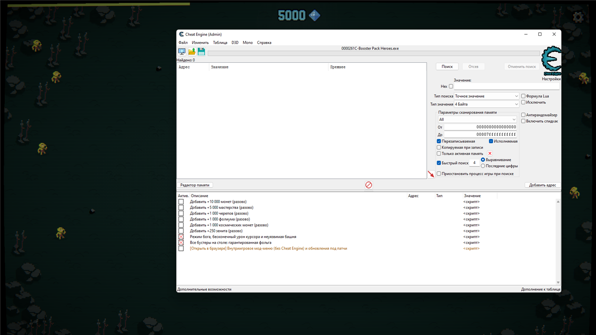

# Booster Pack Heroes - Мод-меню и таблица .CT

Стартовый запас валют, неуязвимая башня, урон курсора, 100% фольгированные и гигантские карты в бустерах + сохранение и `.CT` (`v1.0`, версия `1.0.30d`, Windows, Steam Deck и macOS).

## Скачать
- **[Страница игры и все архивы на Boosty](https://boosty.to/cd_tixo/posts/955a2671-c452-4955-b234-15400619ae78?utm_source=github&utm_medium=readme&utm_campaign=booster_pack_heroes)**
- **[Архивы на GitHub Releases](https://github.com/neoru-droid/booster-pack-heroes-mod-ru/releases)**
- **Ранний доступ и заказ своей игры:** новинки на 48 ч раньше от `120 ₽`, своя игра в очередь - `350 ₽`, вне очереди - `750 ₽` на [Boosty](https://boosty.to/cd_tixo?utm_source=github&utm_medium=readme&utm_campaign=order_game)

## Установка
1. **Windows:** закройте игру, распакуйте архив и запустите `BoosterPackHeroes-Trainer-Setup.exe` -> **«Установить мод-меню»**.
2. **Steam Deck / Linux (Proton):** распакуйте архив, выполните `sh install-steamdeck.sh` и добавьте в параметры запуска Steam: `WINEDLLOVERRIDES="version=n,b" %command%`.
3. **macOS:** откройте `install-macos.command` (Wine / CrossOver / Whisky) или используйте `blackbox_save_v1.json` для нативной `.app`.
4. **В игре:** `F1` или `L3 + R3` открывает окно, `Alt+1..8` запускают быстрые команды.

## Функции мод-меню

- **Ресурсы и бой:** `Alt+1` `+10 000` монет, `Alt+2` `+5 000` мастерства, `Alt+3` `+1 000` черепов, `Alt+4` `+1 000` фолиума, `Alt+5` `+1 000` космо-монет и `+250` зенита, `Alt+6` режим бога, `Alt+7` урон курсора, `Alt+8` неуязвимость башни.
- **Бустеры и карты:** гарантированная фольга, гигантские карты, мгновенное открытие паков на столе, начисление фруктов, осколков и чернил (`+500`).

## Сохранение и таблица Cheat Engine

- **Сохранение (`BoosterPackHeroes-CheatMod-v1.0.zip`):** `blackbox_save_v1.json` (`999 999` монет, `50 000` мастерства, `5 000` черепов/фолиума/космо-монет, `1 000` зенита) -> `%USERPROFILE%\AppData\LocalLow\zup games\Booster Pack Heroes\blackbox_save_v1.json`.
- **Таблица (`BoosterPackHeroes_RU_v1.0.CT`):** 8 скриптов на все основные валюты, режим бога, башню и гарантированную фольгу.

Нашли баг после патча - пишите в [Issues](https://github.com/neoru-droid/booster-pack-heroes-mod-ru/issues).

[Сайт каталога](https://neoru-droid.github.io/) · [Каталог на Boosty](https://boosty.to/cd_tixo/posts/2a55d7e9-0f53-4d93-9f66-280981158dec?utm_source=github&utm_medium=readme&utm_campaign=booster_pack_heroes) · [GitHub](https://github.com/neoru-droid) · [MIT](LICENSE) · Автор: `neoru-droid`
