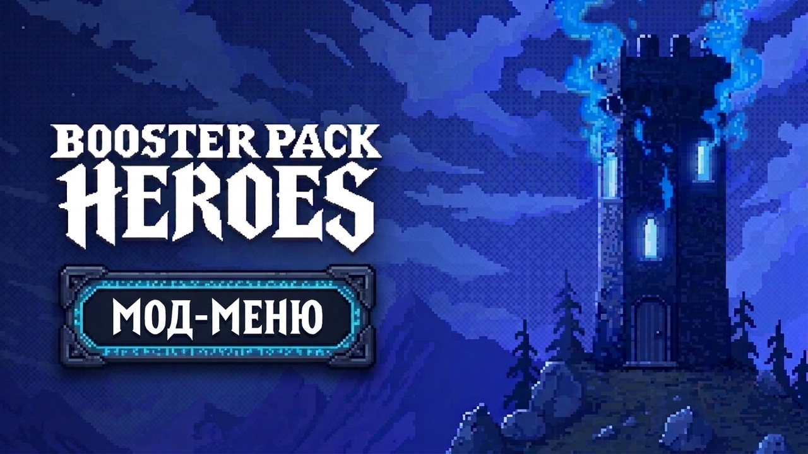
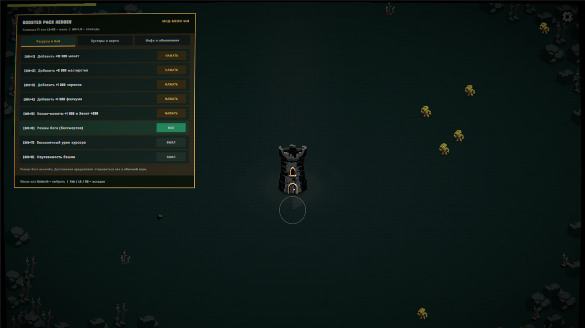

# Booster Pack Heroes - Внутриигровое мод-меню и таблица Cheat Engine (.CT)

Русское внутриигровое мод-меню (`v1.0`), чистое стартовое сохранение `CheatMod` и таблица Cheat Engine для **Booster Pack Heroes** (проверено на версии `1.0.30d`). Достижения продолжают открываться как в обычной игре, а вернуть чистую оригинальную игру можно в один клик без перекачивания в Steam.

## Скачать
- **[Страница релиза на Boosty (актуальная сборка и обновления)](https://boosty.to/cd_tixo/posts/955a2671-c452-4955-b234-15400619ae78)**
- **[Каталог всех проектов автора на Boosty](https://boosty.to/cd_tixo/posts/2a55d7e9-0f53-4d93-9f66-280981158dec)**
- **[GitHub Releases](https://github.com/neoru-droid/booster-pack-heroes-mod-ru/releases)**

Поддерживаются **Windows 10 / 11**, **Steam Deck / Linux (Proton)** и **macOS**.

## Установка мод-меню
1. **Windows:** закройте игру, распакуйте архив и запустите `BoosterPackHeroes-Trainer-Setup.exe` -> **«Установить мод-меню»**.
2. **Steam Deck / Linux (Proton):** распакуйте все файлы рядом и выполните `sh install-steamdeck.sh`, затем добавьте в параметры запуска Steam: `WINEDLLOVERRIDES="version=n,b" %command%`.
3. **macOS:** откройте `install-macos.command` для версии под Wine / CrossOver / Whisky, либо используйте чистый `CheatMod` (`blackbox_save_v1.json`) для нативной `.app` сборки.
4. **Управление в игре:** нажмите клавишу `F1` (или `L3 + R3` на геймпаде), чтобы открыть или скрыть окно мод-меню; `Alt+1..8` запускают быстрые команды.

## Возможности внутриигрового мод-меню

### Вкладка «Ресурсы и бой»
- `Alt+1` - Добавить +10 000 монет
- `Alt+2` - Добавить +5 000 мастерства
- `Alt+3` - Добавить +1 000 черепов
- `Alt+4` - Добавить +1 000 фолиума
- `Alt+5` - Космические монеты +1 000 и Зенит +250
- `Alt+6` - Режим бога (бессмертие)
- `Alt+7` - Бесконечный урон курсора
- `Alt+8` - Неуязвимость башни

### Вкладка «Бустеры и карты»
- Все паки на столе: гарантированная фольга (переключатель)
- Все паки на столе: гигантские карты (переключатель)
- Принудительная фольга на следующем паке и мгновенное открытие всех паков
- Отдельное начисление космических монет (+1 000), зенита (+250), фруктов и осколков (+500), чернил (+500)

### Вкладка «Инфо и обновления»
- Справка по версиям, управление, быстрый переход на Boosty и сброс переключателей.

## Стартовое сохранение (CheatMod) и таблица Cheat Engine

- **CheatMod (`BoosterPackHeroes-CheatMod-v1.0.zip`):** чистый архив без `.exe` и `.dll` со стартовым `blackbox_save_v1.json` (999 999 монет, 50 000 мастерства, 5 000 черепов/фолиума/космо-монет, 1 000 зенита). Перед заменой сохраните свой файл `%USERPROFILE%\AppData\LocalLow\zup games\Booster Pack Heroes\blackbox_save_v1.json`.
- **Таблица Cheat Engine (`BoosterPackHeroes_RU_v1.0.CT`):** 8 русских IL2CPP-скриптов для быстрого начисления валют (+10 000 монет, +5 000 мастерства, +1 000 черепов, +1 000 фолиума, +1 000 космических монет, +250 зенита), режима бога с неуязвимостью башни и гарантированной фольги на всех бустерах.

Автор: `neoru-droid`
